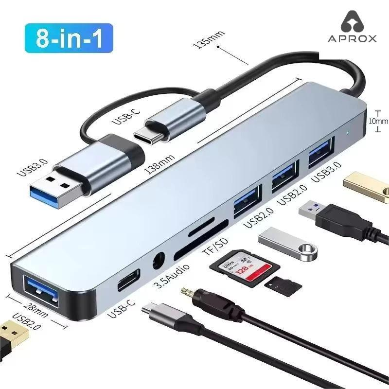

**Escolha o hub pelas conexões que você precisa usar ao mesmo tempo.** Para mouse e teclado, a decisão é diferente de ligar um monitor, transferir arquivos e carregar o notebook. “8 em 1” conta funções anunciadas; não comprova compatibilidade com todas as portas USB-C.

## Faça uma lista antes de escolher o modelo

Escreva quais aparelhos serão conectados e quais portas eles usam. Um receptor de mouse ocupa uma USB-A; um cartão da câmera precisa de leitor compatível; uma tela exige uma saída de vídeo apropriada.

| Sua necessidade | O que verificar no anúncio |
|---|---|
| Mouse e teclado | Quantidade e espaçamento das portas USB-A |
| Transferir fotos | Formatos SD/microSD e especificação do leitor |
| Monitor externo | Tipo de saída, resolução e taxa de atualização |
| Carregar o notebook | Entrada PD, potência entregue e requisitos da fonte |
| Internet por cabo | Porta Ethernet e velocidade declarada |

Compare portas utilizáveis, não apenas o total impresso na embalagem. Uma conexão pode ser destinada somente à alimentação.

## Todo USB-C transmite imagem?

Não. O formato do conector não confirma a função de vídeo. A ASUS orienta consultar a especificação do modelo e distingue soluções com DisplayPort Alt Mode de soluções DisplayLink, que dependem de software próprio.

Para um hub HDMI que depende de DP Alt Mode, confira esse recurso na porta do notebook. Uma solução DisplayLink é outra categoria de produto: não presuma que um adaptador genérico tenha essa tecnologia.

## “4K” no anúncio é informação suficiente?

Peça a resolução junto da frequência: “4K” sem informar quantos hertz deixa a comparação incompleta. Confira também as condições exigidas da porta do computador, do cabo e do monitor.

Se a intenção é jogar em alta frequência, escreva a combinação exata que você quer usar, como resolução e hertz, e procure confirmação explícita. Não compre supondo que uma saída anunciada para determinada combinação também aceite qualquer outra. O [guia de monitores para setup](/blog/monitor-para-setup-como-comparar/) ajuda a organizar essa escolha.

## Hub com PD vem com carregador?

Não necessariamente. Confira o conteúdo da caixa e se a porta PD recebe energia de uma fonte externa. Compare a potência que o fabricante informa para o notebook, não apenas o limite de entrada estampado no hub.

Também confirme se o notebook aceita carregamento pela porta escolhida. Para máquinas que exigem muita energia, não substitua a fonte original sem verificar os requisitos do modelo.

## Leitor barato ou hub completo?

Se você precisa somente copiar fotos de um cartão, um leitor dedicado pode evitar pagar por conexões que não serão usadas. Se a mesa tem vários periféricos, faça a conta do conjunto e verifique espaço para conectar cabos lado a lado.

A [seleção de leitores e adaptadores USB](/shopee-gamer/#leitor-cartao-usb) reúne anúncios cadastrados. Alguns títulos misturam “hub” e “leitor”; confira o desenho das portas e a variante antes de comprar. Não presumimos HDMI ou carregamento em todos eles.

## Checklist para fechar a compra

- Identifique o modelo completo do notebook e a porta disponível.
- Liste as conexões simultâneas necessárias.
- Confirme as especificações no manual do hub.
- Verifique cabo, fonte e acessórios incluídos.
- Compare o total com frete para a mesma configuração.

### Fonte e método

[ASUS: como identificar USB-C com função de vídeo](https://www.asus.com/br/support/faq/1048768/), consultada em 12/11/2026. Guia de compatibilidade e compra, sem teste dos hubs da seleção. Use a documentação do modelo específico para confirmar suas funções.
