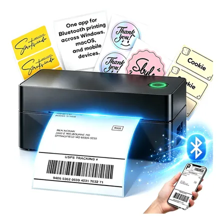

**Uma mini impressora térmica organiza etiquetas; uma caneta 3D extruda material; filamento é consumível para um equipamento compatível.** O nome “impressora” aparece nos anúncios, mas as funções não são intercambiáveis.

Comece pelo resultado: identificar itens, criar pequenas formas ou abastecer a impressora que você já tem.

## Resposta rápida: mini impressora de etiquetas vale a pena?

**Pode fazer sentido para identificar caixas, pastas, produtos e itens de organização**, desde que o modelo aceite as medidas de etiqueta e o celular que você usa. Antes de comprar, confira se o Bluetooth funciona com o aplicativo indicado no anúncio: conexão Bluetooth, sozinha, não garante impressão direta por qualquer app.

### Três critérios antes de comprar

1. **Tamanho de etiqueta:** confirme largura, comprimento máximo e se imprime etiquetas pré-cortadas ou rolos contínuos.
2. **Custo do consumível:** verifique preço e disponibilidade das etiquetas compatíveis; sem isso, o equipamento barato pode sair caro.
3. **Tipo de impressão:** uma mini impressora térmica de etiquetas não substitui impressora A4, uma impressora de envio logístico ou uma impressora 3D.

**E para envios de e-commerce?** Não presuma compatibilidade com etiquetas de transporte 100 × 150 mm. Confirme o tamanho aceito, o formato de arquivo e o fluxo do aplicativo com o vendedor.

[Conferir a mini impressora Bluetooth do catálogo](https://meli.la/33RTYB9){:target="_blank" rel="sponsored nofollow noopener noreferrer"} · Link de afiliado; confirme a variante, os rolos incluídos e o valor final.

## Mini impressora térmica

Confira aplicativo, sistema do celular, largura do rolo e dimensões das etiquetas. Se você pretende imprimir uma etiqueta de transporte, peça uma amostra nesse formato; não assuma que um equipamento pequeno aceita o layout necessário.

A impressão térmica direta usa calor no material adequado. Isso não significa que qualquer papel, adesivo ou etiqueta serve no modelo. O consumível também entra no custo da compra.

## Caneta 3D

Confirme material e diâmetro de filamento, alimentação e controle de temperatura. A caneta exige manejo; não é o mesmo que uma impressora que executa um arquivo automaticamente.

Se a compra é para uma criança, consulte a indicação etária e as orientações de supervisão do fabricante. Não prometemos segurança ou facilidade a partir do nome “profissional”.

## PLA de 1 kg

No filamento com aparência de granito, confira diâmetro, faixa de temperatura e orientação para bico. O efeito visual não garante compatibilidade com todo equipamento nem uma velocidade específica.

A Prusa descreve PLA como material usual para modelos e protótipos que não exigem alta resistência térmica ou mecânica. Isso é referência sobre o material, não certificação desse rolo.

## Qual compra faz sentido?

| Objetivo | Comece por |
|---|---|
| Etiquetas para organizar objetos | Modelo térmico e consumível compatível |
| Desenhar formas manualmente | Caneta, material e orientação de uso |
| Imprimir projetos no equipamento existente | Filamento compatível e perfil adequado |

### Perguntas frequentes

**Impressora térmica precisa de tinta?** A térmica direta utiliza papel ou etiqueta sensível ao calor, sem cartucho de tinta tradicional; confirme o método do modelo, pois há tecnologias térmicas diferentes.

**Funciona no iPhone e no Android?** Depende de aplicativo e versão de sistema compatíveis com o produto exato. Verifique as lojas de aplicativos e o manual antes da compra.

**Imprime etiqueta dos Correios ou Mercado Livre?** Só se dimensões, formato e integração forem suportados. Um anúncio genérico de mini impressora não é prova dessa compatibilidade.

Veja também o [catálogo de acessórios e tecnologia]({{ '/catalogo/' | relative_url }}) para comparar alternativas.

### Fontes

[Prusa: PLA](https://help.prusa3d.com/article/pla_2062?product=mini) e [Brother: métodos de impressão térmica](https://support.brother.com.edgesuite.net/g/b/faqend.aspx?c=us_ot&faqid=faqp00100572_000&ftype3=100182&lang=en&pfs=1&prod=lptd4420tneus), consultadas em 12/10/2026. Critérios gerais, sem teste dos produtos anunciados.

## Anúncios desta categoria: o que muda na escolha

As informações abaixo identificam o que conferir em cada anúncio da vitrine. Não são notas de teste ou um ranking. Abra a loja para verificar a configuração entregue e o preço final.

Comparar os 3 anúncios desta seleção

| Anúncio | Ponto que muda a compra |
|---|---|
| [Caneta 3d Impressora Profissional + Refil Filamento + Usb]({{ '/' | relative_url }}?produto=MLB5649300420#ofertas) | Confira diâmetro, material, faixa térmica e orientação para bico; o efeito granito não demonstra desempenho em alta velocidade. |
| [Mini Impressora Etiquetas Térmica Bluetooth Portatil Armazém Preto 127/220v]({{ '/' | relative_url }}?produto=MLB4849013383#ofertas) | Confira aplicativo, largura de rolo e tamanho da etiqueta; peça amostra do formato que você precisa imprimir. |
| [Filamento Pla Premium 1kg Granito High Speed Impressora 3d]({{ '/' | relative_url }}?produto=MLB5472135448#ofertas) | Confira diâmetro, material, faixa térmica e orientação para bico; o efeito granito não demonstra desempenho em alta velocidade. |

