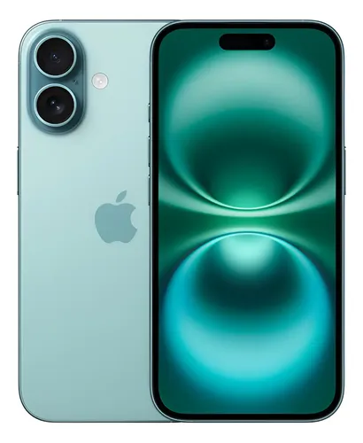

Se os dois cabem no orçamento, a dúvida é justa: vale economizar no iPhone 15 ou levar os recursos extras do 16? **O 15 continua interessante quando a diferença final é relevante. O 16 ganha sentido se você quer macro, novos controles e recursos de IA compatíveis.**

Para quem já tem um 15 funcionando bem, trocar apenas porque o número mudou costuma ser uma compra difícil de justificar. Para quem vem de um aparelho mais antigo, a conversa é outra.

## Resposta rápida: o iPhone 16 de 128 GB vale a pena?

**Pode valer para quem vem de um iPhone antigo, quer o chip A18 e pretende usar os recursos compatíveis com Apple Intelligence.** O iPhone 15 pode ser mais racional quando a diferença de preço é grande e essas funções não são prioridade. Para quem grava vídeos longos e instala jogos pesados, os **128 GB** podem ser uma limitação antes do desempenho.

Na comparação, use o mesmo armazenamento, condição do aparelho, vendedor e custo total. [Veja o anúncio específico do iPhone 16 de 128 GB](https://meli.la/2rdCTEV){:target="_blank" rel="sponsored nofollow noopener noreferrer"} (link de afiliado; preço e estoque são confirmados na loja).

## O que muda no uso

| Recurso | iPhone 15 | iPhone 16 |
|---|---|---|
| Chip | A16 Bionic | A18 |
| Tela | OLED de 6,1 polegadas | OLED de 6,1 polegadas |
| Porta | USB-C | USB-C |
| Controles | Chave de silencioso | Botão de Ação e Controle da Câmera |
| Foto macro | Não consta como recurso | Disponível pela ultra-angular |

Essas diferenças constam nas fichas da Apple. A conclusão de compra é nossa: se você usa o celular para mensagens, mapas, banco e fotos ocasionais, os controles adicionais podem pesar menos que a economia. Se fotografa objetos pequenos ou quer explorar os recursos extras do 16, eles deixam de ser apenas novidade.

## Faça a conta com versões equivalentes

Compare 128 GB com 128 GB, aparelho novo com novo e a mesma forma de pagamento. Um 16 de 256 GB contra um 15 de 128 GB mistura geração e armazenamento; nesse caso, parte da diferença compra espaço.

Some o frete e o total das parcelas. Depois pergunte: **o que farei no 16 que hoje não consigo fazer, ou faço com dificuldade?** Se a resposta for vaga, não há motivo para correr.

## Qual eu escolheria em cada situação?

- **Quero continuar no iOS gastando menos:** colocaria o 15 na lista e compararia o valor final.
- **Quero macro e os controles novos:** olharia o 16, confirmando que os recursos servem à rotina.
- **Gravo muito vídeo:** decidiria a capacidade antes da geração.
- **Já tenho um 15 em bom estado:** avaliaria bateria, espaço e a necessidade real de troca.

## Dúvidas que mudam a decisão

**USB-C significa a mesma velocidade em qualquer cabo?** Não. Porta, aparelho e cabo determinam os recursos disponíveis. Veja o guia de carregamento abaixo.

**O 16 é automaticamente melhor custo-benefício?** Não. Mais recursos não dizem quanto vale a diferença para você.

**Vale decidir pelo desconto riscado?** Compare o total cobrado. O preço de referência da loja não comprova o menor preço do mercado.

Veja também [o guia de celulares]({{ '/blog/qual-celular-comprar-2026/' | relative_url }}) e [como escolher fonte e cabo]({{ '/blog/carregador-usb-c-iphone-como-escolher/' | relative_url }}).

### Perguntas comuns sobre o iPhone 16

**O iPhone 16 de 128 GB é suficiente?** Para mensagens, redes sociais e fotos ocasionais, pode ser. Se você grava muitos vídeos em alta resolução ou mantém jogos grandes instalados, verifique o espaço usado no aparelho atual e compare também 256 GB.

**Vale trocar o iPhone 15 pelo 16?** Compare o ganho real de recursos com a diferença de preço. Uma troca apenas pela geração, sem necessidade concreta, pode não compensar.

**O iPhone 16 é compatível com Apple Intelligence?** O modelo base é compatível, mas a disponibilidade de funções depende de idioma, versão do sistema e requisitos da Apple.

Veja também [o guia de celulares por perfil]({{ '/blog/qual-celular-comprar-2026/' | relative_url }}).

### Fontes e método

[Apple: iPhone 15](https://support.apple.com/pt-br/111831) e [iPhone 16](https://support.apple.com/pt-br/121029), consultadas em 12/10/2026. Comparativo de especificações e critérios de compra, sem teste físico próprio.
