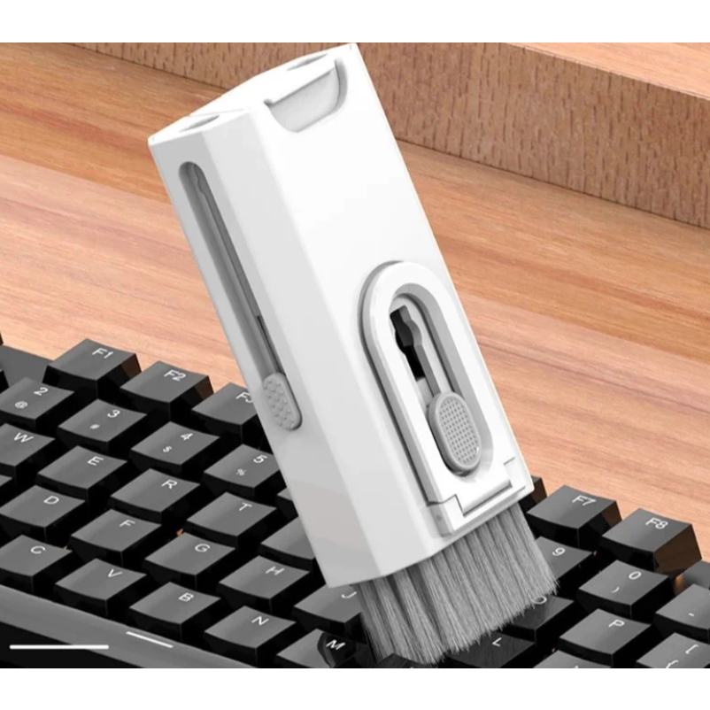

**Um kit de limpeza de teclado faz sentido quando suas peças resolvem a sujeira que você realmente encontra.** Para poeira superficial, avalie primeiro acessórios simples. Um estojo com muitas ferramentas não garante que todas possam ser usadas no seu teclado, na tela ou nos fones.

## Kit 2 em 1 ou 8 em 1: o que muda?

A contagem pode incluir escova, pano, reservatório, extrator e pequenas pontas. Não existe equivalência automática entre dois anúncios com o mesmo número de funções. Abra a lista do conteúdo da embalagem e confira a função de cada peça.

| Peça anunciada | O que conferir antes de usar |
|---|---|
| Escova | Material das cerdas e indicação para a superfície |
| Pano de microfibra | Limpeza do próprio pano e ausência de partículas |
| Frasco ou spray | Se vem vazio e qual produto o fabricante permite |
| Extrator de teclas | Compatibilidade com o mecanismo do teclado |
| Ponta estreita | Se o manual autoriza contato com aquela área |

Um frasco nas fotos pode chegar sem líquido. Também pode haver variantes com conteúdo diferente dentro do mesmo anúncio.

## O que verificar antes de limpar

Desligue o equipamento e desconecte a alimentação. A Dell recomenda esse cuidado antes da limpeza e orienta o uso de pano de microfibra. O procedimento e o produto permitido devem seguir o manual do seu aparelho, sobretudo quando há revestimento na tela.

Evite improvisar uma mistura porque ela aparece no anúncio do kit. Um líquido adequado a uma superfície pode não ser indicado para outra. Não borrife diretamente sobre o equipamento; siga a forma de aplicação prevista pelo fabricante.

## Posso tirar as teclas do notebook?

Não presuma que pode. Um extrator vendido para teclado mecânico não confirma compatibilidade com as teclas do notebook. Antes de tentar removê-las, consulte a orientação específica do modelo. Se não houver procedimento autorizado para o usuário, limite a limpeza à parte acessível.

O mesmo cuidado vale para colocar pontas dentro de conectores, grades e saídas de ar. O fato de uma ferramenta caber não significa que o uso seja recomendado.

## Como escolher um kit barato que seja útil

Compare a mesma quantidade de peças, o conteúdo real e o frete. Se você já tem um pano adequado, talvez precise apenas de uma escova compatível. Se trabalha com vários aparelhos, um estojo pode facilitar guardar os acessórios separados.

Na [seleção de kits de limpeza](/shopee-gamer/#kit-limpeza-teclado), há anúncios com diferentes propostas. Leia a variante antes de pagar: o menor preço pode corresponder a uma escova avulsa. A presença na seleção não é certificação de compatibilidade com todos os eletrônicos.

## Quando a limpeza externa não resolve

Tecla falhando, líquido derramado e sujeira interna exigem outro diagnóstico. Um kit de limpeza externa não é reparo para contatos ou componentes. Se o problema começou após derramamento, siga o suporte do fabricante em vez de continuar usando o aparelho para testar.

Para reduzir a bagunça ao redor do computador, veja o [guia de suporte para notebook](/blog/suporte-para-notebook-como-escolher/) e reserve um local para guardar os acessórios limpos.

## Perguntas frequentes

### Kit de teclado também serve para monitor?

Somente as peças e produtos indicados para a tela pelo fabricante. Não use a mesma escova com detritos sobre o painel.

### Mais peças significa melhor compra?

Não. Conte quantas têm utilidade e compatibilidade para você. Compare o custo final do kit com comprar apenas os acessórios necessários.

### Fonte e método

[Dell: limpeza e manutenção de computadores](https://www.dell.com/support/kbdoc/pt-br/000124077/como-limpar-e-manter-seu-computador-dell), consultada em 12/11/2026. Guia editorial, sem testes próprios de limpeza ou dos materiais dos kits.
