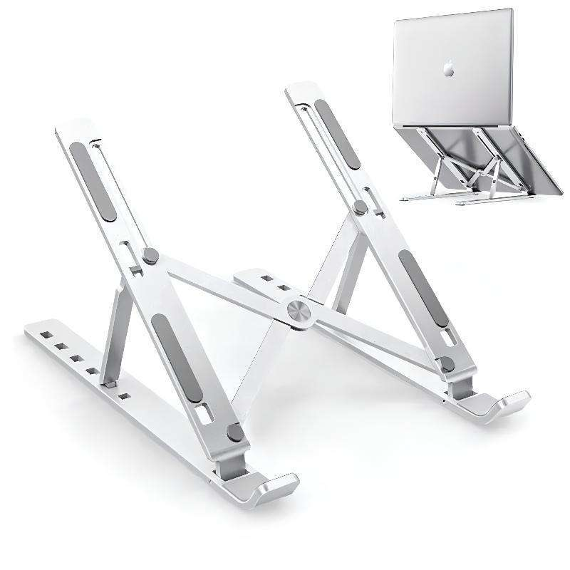

**Para uma mesa pequena, comece pelas medidas do suporte aberto e pelo espaço que sobra para digitar.** Um modelo dobrável pode facilitar o transporte; uma base elevada pode liberar parte do tampo. A escolha depende de como você usa o notebook, não apenas do tamanho da tela.

## Qual tipo de suporte faz sentido?

| Tipo | Quando considerar | O que conferir |
|---|---|---|
| Dobrável inclinado | Você guarda o acessório após o uso | Travas, pés e posição dos apoios |
| Elevado com plataforma | Você usa teclado e mouse separados | Altura, profundidade e estabilidade |
| Base com cooler | Você quer avaliar ventilação adicional | Alimentação, ruído e posição dos ventiladores |
| Vertical para notebook fechado | Você usa monitor externo | Compatibilidade com uso fechado e espessura do aparelho |

Um suporte vertical não serve para usar a tela do próprio notebook. Já uma base com cooler ocupa espaço e pode exigir uma porta USB. Escolha a função que resolve sua mesa antes de comparar acabamentos.

## Meça três coisas antes da compra

Anote largura e profundidade do notebook, depois a área livre da mesa. Por fim, observe onde ficam os pés e as entradas de ar na parte de baixo do aparelho. Compare essas medidas com o desenho do suporte, incluindo os ganchos dianteiros.

A indicação “até 17 polegadas” descreve uma faixa de telas; ela não informa sozinha se o chassi fica bem apoiado. Confira também o peso suportado declarado pelo fabricante. Se o anúncio não mostra medidas nem capacidade, peça essas informações antes de comprar.

## Suporte de alumínio é melhor que plástico?

O material, isoladamente, não decide. Um modelo de alumínio pode ter articulações frouxas; um suporte plástico pode atender a um equipamento leve se tiver estrutura e capacidade adequadas. Compare a construção, os pontos de contato e as travas.

Para quem precisa transportar o conjunto, peso e tamanho fechado entram na conta. Para deixar na mesa, pode valer mais a estabilidade do que economizar alguns gramas.

## Ele diminui a temperatura do notebook?

Pode ajudar a manter as aberturas livres, mas não há uma redução garantida em graus. A Lenovo orienta usar superfície firme e manter a ventilação desobstruída. Não coloque apoios sobre as entradas de ar e não trate uma base como solução comprovada para superaquecimento.

Sem testar o mesmo notebook, na mesma tarefa e nas mesmas condições, não dá para afirmar que um suporte resfria mais que outro.

## Como comparar o preço sem errar a variante

Verifique se o menor valor corresponde ao suporte completo, ao tamanho desejado e ao material anunciado. Some o frete. Fotos de várias versões no mesmo anúncio não significam que todas estejam incluídas.

Na [seleção de suportes para notebook](/shopee-gamer/#suporte-notebook), confira as opções cadastradas e o preço na loja. Para reorganizar o restante da mesa, veja também [como escolher mouse, teclado e acessórios](/blog/mouse-teclado-acessorios-setup/).

## Dúvidas rápidas

### Preciso de teclado externo?

Se você elevar bastante o notebook, planeje onde vai digitar. Um teclado externo permite posicioná-lo separado da tela, mas ocupa uma área adicional que precisa entrar nas medidas.

### A base com cooler vale o preço extra?

Depende de compatibilidade, ruído e resultado no seu aparelho. Sem uma necessidade identificada, compare primeiro um suporte simples que mantenha as aberturas livres.

### Fonte e método

[Lenovo: ventilação e resfriamento do notebook](https://www.lenovo.com/us/en/glossary/how-to-cool-down-your-laptop/), consultada em 12/11/2026. Orientação editorial de compra; não realizamos testes de estabilidade, ergonomia ou temperatura nos anúncios citados.
